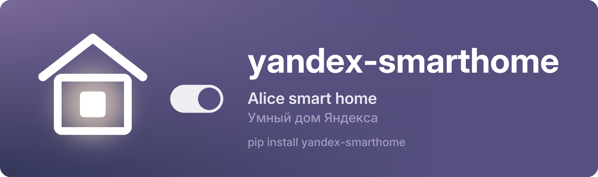

<p align="center"><a href="https://github.com/nowplaylab/yandex-smarthome"></a></p>

<p align="center"><b>English</b> &nbsp;·&nbsp; <a href="https://github.com/nowplaylab/yandex-smarthome/blob/main/README.ru.md">Русский</a> &nbsp;·&nbsp; <a href="https://pypi.org/project/yandex-smarthome/">PyPI</a></p>

<p align="center">
<a href="https://pypi.org/project/yandex-smarthome/"></a>
<a href="https://github.com/nowplaylab/yandex-smarthome/actions/workflows/tests.yml"></a>

<a href="https://github.com/nowplaylab/yandex-smarthome/blob/main/LICENSE"></a>
</p>

Yandex Smart Home (Alice) from Python: **sign in with a code** — the user types it on Yandex's page, your program never sees the password — and control lights: colour, white temperature, brightness, on/off, with a snapshot to put everything back as it was.

Made by [nowplaylab](https://github.com/nowplaylab) for [NowPlaying](https://github.com/nowplaylab/nowplaying-display), where lamps follow the album cover.

## Install

```
pip install yandex-smarthome
```

Python 3.9+. You need your own app at [oauth.yandex.ru/client/new](https://oauth.yandex.ru/client/new) with the **iot:view** and **iot:control** scopes. Its client secret is required for the code sign-in.

## Use

```python
import aiohttp
from yandex_smarthome import DeviceLogin, SmartHome, light_actions

async def main():
    async with aiohttp.ClientSession() as http:
        login = DeviceLogin(CLIENT_ID, CLIENT_SECRET)
        code = await login.start(http, device_id='my-pc', device_name='My program')
        print('Open', code.url, 'and enter', code.user_code)
        token = await login.wait(http, code)          # Token(access, refresh, expires_at) — store it safely

        home = SmartHome(token.access)
        lights = await home.lights(http)              # [Light(id, name, room, model, tmin, tmax, brightness, state)]
        before = {l.id: l.state for l in lights}      # to restore later
        failed = await home.actions(http, {l.id: light_actions(l, hsv=(30, 0.9), kelvin=2700, brightness=80) for l in lights})
        print(failed)                                 # {device_id: 'DEVICE_UNREACHABLE', ...}, empty if all lamps obeyed
        ...
        await home.actions(http, before)              # back as it was
```

- `light_actions()` sends colour in the lamp's own format (`hsv` or `rgb`); a white-only lamp gets `kelvin`, clamped to its range.
- `actions()` returns the lamps that did not obey, with Yandex's error code. Yandex answers "ok" to the whole request even when a lamp is unplugged or offline, so check this.
- `SmartHome` raises `AuthError` when the token stops working: call `login.refresh(http, token.refresh)` or sign in again.
- Yandex drives lamps through its cloud, so a change takes about half a second to a second, and frequent commands are not welcome. One change per event (a new track, say) works well; flashing to the beat does not.

## Licence

MIT. Not affiliated with Yandex.
