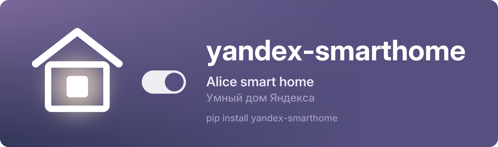

<p align="center"><a href="https://github.com/nowplaylab/yandex-smarthome"></a></p>

<p align="center"><a href="https://github.com/nowplaylab/yandex-smarthome/blob/main/README.md">English</a> &nbsp;·&nbsp; <b>Русский</b> &nbsp;·&nbsp; <a href="https://pypi.org/project/yandex-smarthome/">PyPI</a></p>

<p align="center">
<a href="https://pypi.org/project/yandex-smarthome/"></a>
<a href="https://github.com/nowplaylab/yandex-smarthome/actions/workflows/tests.yml"></a>

<a href="https://github.com/nowplaylab/yandex-smarthome/blob/main/LICENSE"></a>
</p>

Умный дом Яндекса (Алиса) из Python: **вход по коду** — человек вводит его на странице Яндекса, программа пароль не видит — и управление светом: цвет, оттенок белого, яркость, вкл/выкл, плюс снимок состояния, чтобы вернуть всё как было.

Сделано [nowplaylab](https://github.com/nowplaylab) для [NowPlaying](https://github.com/nowplaylab/nowplaying-display): там лампы берут цвет обложки.

## Установка

```
pip install yandex-smarthome
```

Python 3.9+. Нужно своё приложение на [oauth.yandex.ru/client/new](https://oauth.yandex.ru/client/new) с правами **iot:view** и **iot:control**. Для входа по коду обязателен его секрет (client secret).

## Как пользоваться

```python
import aiohttp
from yandex_smarthome import DeviceLogin, SmartHome, light_actions

async def main():
    async with aiohttp.ClientSession() as http:
        login = DeviceLogin(CLIENT_ID, CLIENT_SECRET)
        code = await login.start(http, device_id='my-pc', device_name='Моя программа')
        print('Откройте', code.url, 'и введите', code.user_code)
        token = await login.wait(http, code)          # Token(access, refresh, expires_at) — храните надёжно

        home = SmartHome(token.access)
        lights = await home.lights(http)              # [Light(id, name, room, model, tmin, tmax, brightness, state)]
        before = {l.id: l.state for l in lights}      # чтобы вернуть потом
        failed = await home.actions(http, {l.id: light_actions(l, hsv=(30, 0.9), kelvin=2700, brightness=80) for l in lights})
        print(failed)                                 # {device_id: 'DEVICE_UNREACHABLE', ...}, пусто, если все лампы послушались
        ...
        await home.actions(http, before)              # как было
```

- `light_actions()` отдаёт цвет в формате самой лампы (`hsv` или `rgb`); лампа только с белым получает `kelvin` в пределах своего диапазона.
- `actions()` возвращает лампы, которые не послушались, с кодом ошибки Яндекса. Яндекс отвечает «ok» на весь запрос, даже когда лампа обесточена или без сети, поэтому смотрите сюда.
- `SmartHome` бросает `AuthError`, когда вход перестал действовать: вызовите `login.refresh(http, token.refresh)` или войдите заново.
- Лампами Яндекс управляет через облако: изменение доходит за полсекунды–секунду, частые команды он не любит. Одно изменение на событие (например, на новый трек) — хорошо; мигание в такт — нет.

## Лицензия

MIT. Проект не связан с Яндексом.
